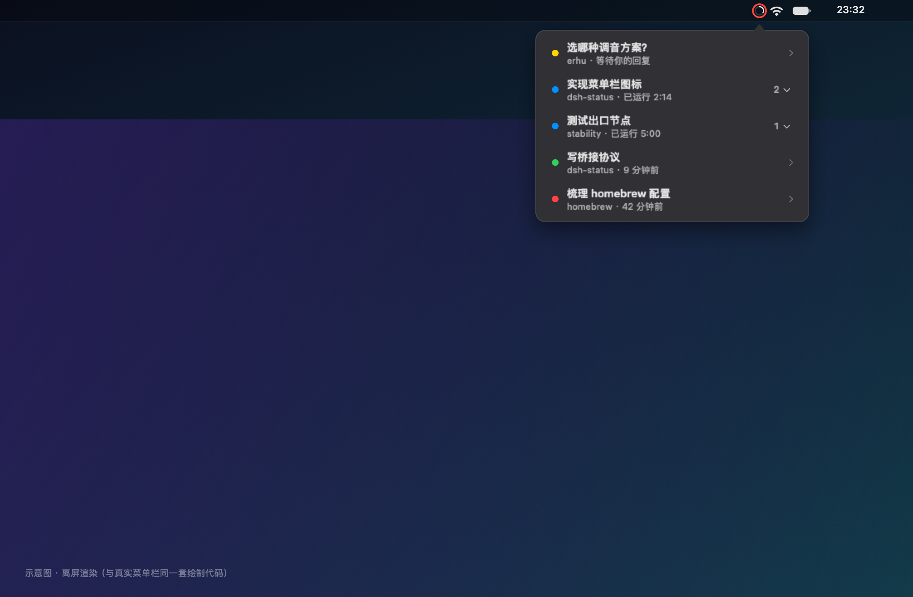
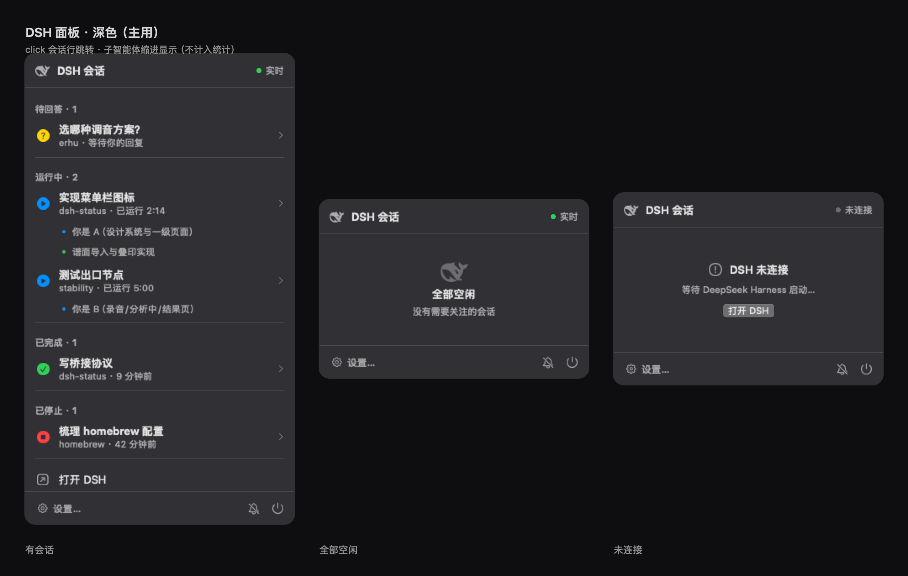
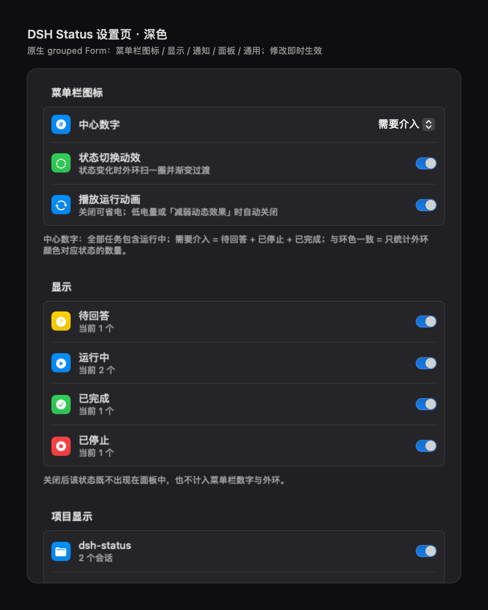

# DSH Status

[](https://github.com/HAppy-2436/dsh-status/releases/latest)
[](LICENSE)


**A native macOS menu bar companion for DeepSeek Harness.** It keeps the state of
your DSH sessions visible at all times — how many are running, waiting for you,
finished, or stopped — and shows the details in a native panel with one click.

English · [简体中文](README.zh.md)



*Offscreen render with demo data (no real sessions, titles or project names).*

## Why use it

- **Status at a glance.** The menu bar tells you whether a session needs you
  without switching back to DSH.
- **Only what matters.** The panel lists the sessions that are running, waiting
  for an answer, finished, or stopped — not every session you have ever opened.
- **Native, not a web wrapper.** The app is written in Swift with AppKit and
  SwiftUI, and follows the system's own materials, colors, and typography.
- **Local by design.** The app talks only to a bridge plugin that runs on your
  own machine. There is no account, no cloud sync, and no telemetry.

## Features

### Menu bar icon

- Idle with nothing to report: the DeepSeek whale glyph by default. **Settings →
  Menu bar icon → Idle icon** can switch to the dashed ring used by the "not
  connected" state (same asset, without the minus sign).
- Otherwise a monochrome ring whose color is the highest-priority item:
  red (stopped) > yellow (waiting for you) > green (completed).
- Running sessions animate an arc around the ring. The center number can show
  all tasks (default), only tasks that need you, only the count matching the
  ring color, or nothing.
- Transitions between states are animated; Reduced Motion, Low Power Mode, and
  the in-app animation switches are respected.



*The session panel, offscreen render with demo data (running / waiting / completed / stopped).*

### Session panel

- A flat list of non-idle sessions, most recently changed first.
- A colored dot marks each state: blue running, yellow waiting for an answer,
  green completed, red stopped.
- Subagent sessions are folded under their parent row and expand in place.
- Click a session to open it in DeepSeek Harness.
- When everything is idle — or the bridge is disconnected — the panel shrinks
  to a single compact button that opens DSH.
- Right-click the menu-bar icon for: open DSH, Do Not Disturb, Settings, Quit.

### Notifications and sounds

- A system notification when a session needs an answer, finishes, or stops;
  each state can be enabled separately. Clicking a notification opens the
  session.
- **The session you are viewing also notifies when it finishes.** DSH marks a
  session unread only when it ends while you are away, so a session that ends
  in the main view would otherwise neither notify nor appear as completed. The
  bridge reports that turn end separately: the banner and sound fire as usual,
  and a **transient "completed" row** appears so the menu-bar icon goes
  running → completed with the badge +1. Click the **×** at the end of the row
  to dismiss it (badge −1); sending another message in that session clears it
  automatically too.
- Do Not Disturb silences every notification and sound while keeping the
  individual preferences.
- The alert sound can be the built-in DSH chime, one of eight macOS system
  sounds, a custom audio file (WAV, AIFF, MP3, M4A, CAF), or silent.
- Two delivery modes: **play from the app** (independent volume; not muted by
  Focus) or **attach the sound to the system notification** (follows Focus and
  the system notification volume).

### Background

- **Launch at login** (off by default, macOS 13+). Registers through the system
  login items (`SMAppService`); toggle it in **Settings → Background**. If macOS
  asks for approval, allow DSH Status under **System Settings → General → Login Items**.
- **Prevent idle sleep while sessions are running** (off by default). While at
  least one session is running and the bridge is connected, the app keeps the
  Mac awake; the screen may still turn off, and closing the lid or sleeping
  manually is not blocked.

### Settings

The standard grouped settings window covers the menu-bar icon, display,
projects, notifications, sounds, panel material, background, and general
options (including the app icon — brand double ring or the DeepSeek blue whale —
restore-to-defaults, and quit confirmation).



*The settings window, offscreen render (menu bar icon / display / projects / notifications / sounds / panel / background / general).*

## Requirements

- **macOS 13 or later.** The 0.2.0 build is Apple Silicon (arm64) only.
- **DeepSeek Harness Desktop 0.2.x** with third-party plugin support. Tested
  with 0.2.1-rc.5 and 0.2.2-rc.1.
- **Liquid Glass panel material** requires macOS 26 or later; on older systems
  the panel uses the classic frosted material or a solid fill instead.

## Install

DSH Status has two parts: the menu bar app and a bridge plugin that runs inside
DeepSeek Harness. Install the app first, then the plugin.

### 1. Install the app

1. Download **`DSH-Status-0.2.0.dmg`** from the
   [latest release](https://github.com/HAppy-2436/dsh-status/releases/latest).
2. Open the DMG and drag **DSH Status** into `/Applications`.
3. Open the app from `/Applications`.

The 0.2.0 build is ad-hoc signed and not notarized, so macOS blocks the first
launch. To allow it:

- **Right-click (Control-click) the app → Open**, then confirm **Open**; or
- open **System Settings → Privacy & Security**, scroll down, and click
  **Open Anyway** next to the DSH Status entry.

If macOS instead says that the app **is damaged**, remove the quarantine flag
and open it again:

```bash
xattr -dr com.apple.quarantine "/Applications/DSH Status.app"
```

### 2. Install the bridge plugin

1. Open DeepSeek Harness.
2. In the sidebar, go to **Plugins → Add plugin → Install a third-party plugin**.
3. Enter the package name **`dsh-status-bridge`** and click **Install**.
   If the package is not available from your registry yet, enter the Git URL
   `github:HAppy-2436/dsh-status-bridge` in the same field instead.
4. Click **Enable now** when the installation finishes. If DSH prompts for a
   restart, restart it so the plugin can load.

The plugin lives in its own repository:
[HAppy-2436/dsh-status-bridge](https://github.com/HAppy-2436/dsh-status-bridge).
It writes `~/.dsh-status/bridge.json`, launches the menu bar app automatically,
and keeps it connected while DSH is running.

### 3. Confirm it works

The DSH Status icon appears in the menu bar. If the app did not start
automatically, open **/Applications/DSH Status.app** manually.

Notifications are off until macOS grants permission. Enable them from the
notification row in **Settings**, from the notification entry in the right-click
menu, or later under **System Settings → Notifications → DSH Status**.

## Compatibility and known limitations

| Item | Notes |
| --- | --- |
| Tested macOS | macOS 27.2 (minimum supported: macOS 13) |
| Architecture | Apple Silicon arm64 |
| Tested DeepSeek Harness | 0.2.1-rc.5 and 0.2.2-rc.1 |
| Panel material | Liquid Glass on macOS 26+; frosted / solid fallback below that |

Known limitations:

- **One snapshot for all DSH windows.** When several DSH windows are open, the
  app shows a single merged view based on the most recent state pushed by the
  bridge; per-window breakdowns are not available.
- **Unread counts reset when DSH restarts.** The “needs answer” bookkeeping
  lives in the DSH renderer, so a DSH restart starts the counts from zero.
- **No automatic updates.** New versions are published on the Releases page and
  must be downloaded and installed manually.
- **Not notarized.** The app is ad-hoc signed; the first launch after
  installation needs the Gatekeeper steps above.
- **Sessions that ended before the bridge started** are shown as completed.
- **The app interface is currently in Simplified Chinese.** The documentation
  is bilingual; UI localization has not shipped yet.

## FAQ and troubleshooting

**The icon never connects / the panel says “not connected”.**
Make sure DeepSeek Harness is running and the `dsh-status-bridge` plugin is
enabled. Check that DSH created `~/.dsh-status/bridge.json`. If the file is
missing, disable and re-enable the plugin; if it exists but the app still does
not connect, restart DSH, then open the app again.

**I don't get notifications.**
Open Settings → Notifications and check the permission row, or allow DSH Status
under System Settings → Notifications. Also make sure the three state toggles
are on and that Do Not Disturb is off. With the “system notification sound”
delivery mode, macOS Focus can mute the sound.

**macOS won't open the app.**
Use the Gatekeeper steps in [Install](#install): right-click → Open, or allow it
in System Settings → Privacy & Security. If macOS reports the app is damaged,
run the `xattr` command above and open it again.

**Does the app start when I log in?**
Not by itself. Add it under System Settings → General → Login Items if you want
it to start automatically.

**How do I uninstall it?**
Right-click the menu-bar icon → **Quit**, then drag `/Applications/DSH Status.app`
to the Trash. In DSH, open Plugins and disable or remove `dsh-status-bridge`.
Optionally delete `~/.dsh-status` to remove the bridge token and leftover
settings.

## Development

Requirements: macOS with Xcode Command Line Tools (Swift 5.9 or later), and
Node.js 20+ (or the Node runtime bundled with DeepSeek Harness) for the mock
bridge and the demo script.

```bash
git clone https://github.com/HAppy-2436/dsh-status.git
cd dsh-status

bash scripts/build-app.sh   # build dist/DSHStatusBar.app (release, ad-hoc signed, runs self-tests)
bash scripts/demo.sh        # launch a mock bridge + the app (no DSH needed)
bash scripts/test-bridge.sh # check the bridge protocol against the mock

cd app && swift build -c release   # native SwiftPM build
```

Release packaging is done with `bash scripts/release-dmg.sh`, which produces
`dist/release/DSH-Status-<version>.dmg` and its `.sha256` file.

Repository layout:

- `app/` — the Swift menu bar app (SwiftPM, no third-party dependencies)
- `mock/` — mock bridge used by the demo and protocol tests
- `scripts/` — build, install, demo, test, and DMG packaging scripts
- `docs/` — design documents, previews, and screenshots

The bridge plugin now lives in
[dsh-status-bridge](https://github.com/HAppy-2436/dsh-status-bridge); the wire
protocol between the plugin and the app is documented in
[docs/protocol.md](docs/protocol.md).

## Documentation

| Document | Contents |
| --- | --- |
| [docs/app-design.md](docs/app-design.md) | App design system: menu-bar icon states, panel structure, settings |
| [docs/icon-transitions.md](docs/icon-transitions.md) | Menu-bar icon state transitions and timing |
| [docs/icon-audit.md](docs/icon-audit.md) | Animation and alignment acceptance report |
| [docs/previews/README.md](docs/previews/README.md) | Index of screenshots and design previews |
| [docs/RELEASE.md](docs/RELEASE.md) | Release and DMG packaging process |
| [CHANGELOG.md](CHANGELOG.md) | Release notes |

(The maintainer's local work log is not tracked in this repository.)

## License

DSH Status is released under the [MIT License](LICENSE).
Copyright (c) 2026 HAppy-2436.

Portions of the project are derived from other open-source work:

- The panel window and material implementation is adapted from
  [Status Trio](https://github.com/lingyired/status-trio)
  (Apache License 2.0, Copyright 2026 lingyired).
- The whale logo vector path comes from
  [DeepSeek Harness](https://github.com/deepseek-ai/deepseek-harness)
  (MIT, Copyright (c) 2026 DeepSeek).

The full license texts are in [`LICENSES/`](LICENSES/). Attribution and the list
of modifications are in [THIRD_PARTY_NOTICES.md](THIRD_PARTY_NOTICES.md) and
[`NOTICE`](NOTICE).

## Disclaimer

DSH Status is an unofficial, independent project. It is not affiliated with,
endorsed by, or sponsored by DeepSeek. “DeepSeek” and “DeepSeek Harness” are
trademarks of their respective owners. The “DSH” abbreviation in the project
name refers to DeepSeek Harness and is used in line with DeepSeek's brand
guidance.

The application icon can be the original brand double ring (default) or the
DeepSeek blue whale (**Settings → General → App icon**); it also decides the icon
shown in system notification banners, so a restart is required after switching.
The whale glyph shown in the
menu-bar idle state is derived from DeepSeek Harness under the MIT License.
Status Trio–derived code is used under the Apache License 2.0. See
[THIRD_PARTY_NOTICES.md](THIRD_PARTY_NOTICES.md) for details.
