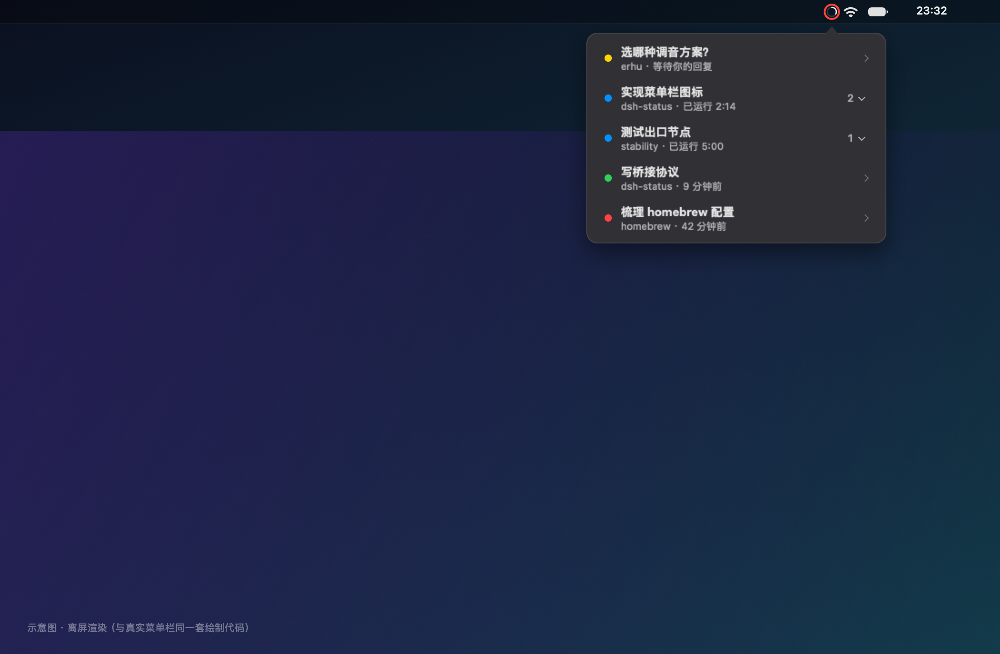
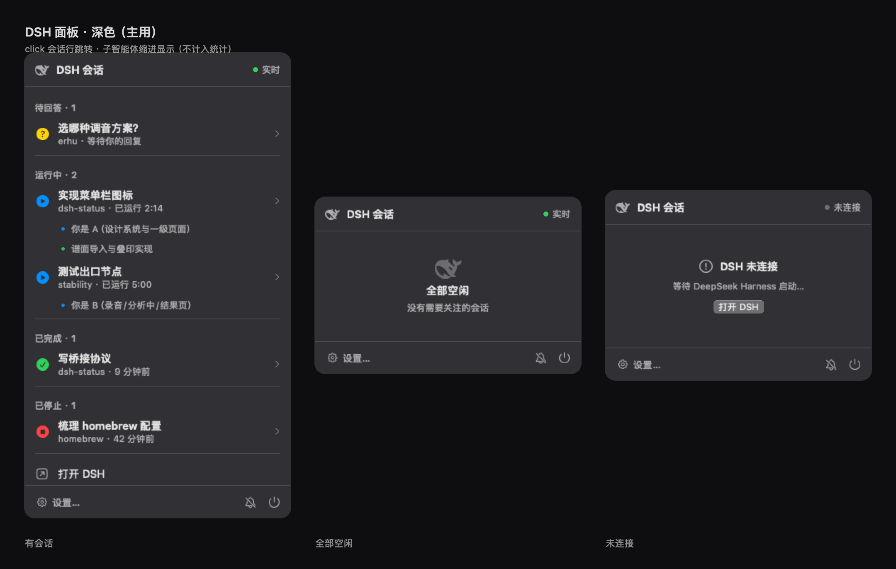
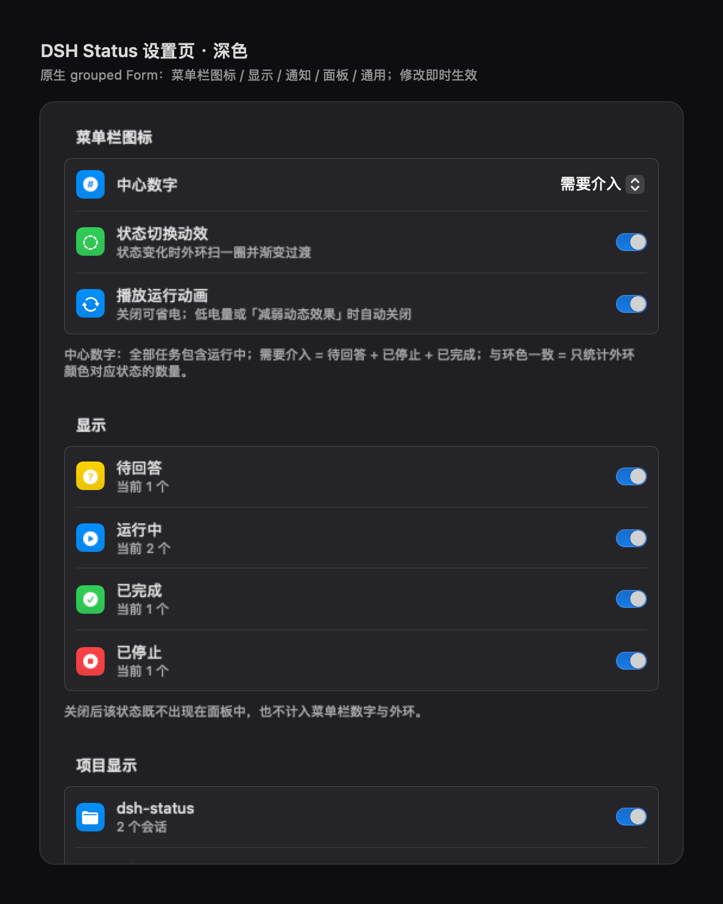

# DSH Status

[](https://github.com/HAppy-2436/dsh-status/releases/latest)
[](LICENSE)


**DeepSeek Harness 的原生 macOS 菜单栏伴侣。** 它把 DSH 会话的状态常驻在菜单栏——
有多少在运行、多少在等你回答、多少刚完成、多少已停止——单击图标即可查看详情。

[English](README.md) · 简体中文



*离屏渲染 + 示例数据：不包含任何真实会话、标题或项目名。*

## 为什么用它

- **一眼看清状态。** 不用切回 DSH，菜单栏就会告诉你是否有会话需要你处理。
- **只看该看的。** 面板只列出运行中、待回答、已完成、已停止的会话，而不是你打开过的全部会话。
- **原生，不是网页套壳。** App 使用 Swift（AppKit + SwiftUI）编写，沿用系统的材质、颜色与字体。
- **数据不出本机。** App 只与本机运行的桥插件通信：没有账号、没有云端同步、没有埋点。

## 功能

### 菜单栏图标

- 完全空闲时默认显示 DeepSeek 鲸鱼图形；可在 **设置 →「菜单栏图标」→「空闲时图标」**
  切换为「未连接」状态的虚线圆环（复用同一素材，不带中间短横）。
- 其余状态显示一圈单色环，颜色取优先级最高的待办：红（已停止）> 黄（待回答）> 绿（已完成）。
- 有会话运行中时，外圈有一段动画圆弧。中心数字可在设置中选择：全部任务（默认）、
  仅需要介入、与环色一致的数量、不显示。
- 状态切换带过渡动画，并遵循「减弱动态效果」、低电量模式与 App 内的动画开关。



*会话面板离屏渲染（运行中 / 待回答 / 已完成 / 已停止，示例数据）。*

### 会话面板

- 非空闲会话的扁平列表，最近发生状态变化的排在前面。
- 行首彩色圆点表示状态：蓝=运行中、黄=待回答、绿=已完成、红=已停止。
- 子智能体会话折叠在父行下，点击行尾按钮即可展开/收起。
- 点击会话行会在 DeepSeek Harness 中打开对应会话。
- 全部空闲或未连接时，面板缩成一块紧凑按钮，点击即打开 DSH。
- 右键菜单栏图标：打开 DSH、勿扰模式、设置、退出。

### 通知与提示音

- 会话进入待回答、已完成、已停止时发送系统通知，三类状态可分别开关；点击通知打开对应会话。
- **正在看的那则会话跑完也会提醒**：DSH 只在「跑完时你不在主视图」才标未读，所以在看的会话
  跑完本来既没有「已完成」行、也不会弹通知。桥按 `turn/end` 补一条完成事件：照常弹横幅、
  响提示音，并补一条**临时「已完成」行**——菜单栏图标走「运行中 → 已完成」、角标 +1。
  **直接点这一行**跳转后会当作「已读」自动清掉（和普通未读行点开即清一致），点通知横幅跳转也一样；
  只想清不想跳转就点行尾 **×**（角标 -1），右键菜单的 **「全部忽略」** 一次清掉所有这类行；
  在该会话里继续发消息也会自动清掉。
- 勿扰模式会静音全部通知与提示音，同时保留各单项偏好。
- 提示音可选：内置 DSH 提示音、8 种 macOS 系统声音、自定义音频文件
  （WAV、AIFF、MP3、M4A、CAF）或静音。
- 两种送达方式：**App 直接播放**（独立音量，不受专注模式静音）或
  **随系统通知播放**（跟随专注模式与系统通知音量）。

### 后台

- **登录时自动启动**（默认关闭，macOS 13+）。通过系统「登录项」（`SMAppService`）注册，
  在 **设置 → 后台** 中开关；若系统要求确认，请在 **系统设置 → 通用 → 登录项** 中允许。
- **有会话运行时阻止闲置睡眠**（默认关闭）。开启后，只要有会话在运行且桥已连接，
  App 就会阻止 Mac 进入闲置睡眠；屏幕仍可关闭，合盖与手动睡眠不受影响。

### 设置

标准分组设置窗口涵盖菜单栏图标、显示、项目、通知、提示音、面板材质、后台与通用选项
（含**应用图标**：品牌双层环 / DeepSeek 蓝色鲸鱼；恢复默认设置、退出前确认）。



*设置窗口离屏渲染（菜单栏图标 / 显示 / 项目显示 / 通知 / 提示音 / 面板 / 后台 / 通用）。*

## 环境要求

- **macOS 13 或更高版本。** 0.2.0 构建仅提供 Apple Silicon（arm64）版本。
- **DeepSeek Harness Desktop 0.2.x**，需支持安装第三方插件；已在 0.2.1-rc.5 与
  0.2.2-rc.1 上实测。
- **液态玻璃（Liquid Glass）面板材质**需 macOS 26 或更高版本；旧系统上会自动使用
  经典磨砂材质或实色背景。

## 安装

DSH Status 由两部分组成：菜单栏 App 和运行在 DeepSeek Harness 里的桥插件。
请先安装 App，再安装插件。

### 1. 安装 App

1. 从[最新 Release](https://github.com/HAppy-2436/dsh-status/releases/latest) 下载
   **`DSH-Status-0.2.0.dmg`**。
2. 打开 DMG，把 **DSH Status** 拖入 `/Applications`。
3. 从 `/Applications` 打开 App。

0.2.0 构建为 ad-hoc 签名、未公证，macOS 会拦截首次打开。放行方式：

- **右键（或 Control-单击）App → 打开**，在弹窗中再点 **打开**；或
- 打开**系统设置 → 隐私与安全性**，向下滚动，点击 DSH Status 条目旁的**仍要打开**。

如果 macOS 提示 App **已损坏**，先清除隔离属性再打开：

```bash
xattr -dr com.apple.quarantine "/Applications/DSH Status.app"
```

### 2. 安装桥插件

1. 打开 DeepSeek Harness。
2. 在左侧边栏进入 **插件 → 添加插件 → 安装第三方插件**。
3. 输入 npm 包名 **`dsh-status-bridge`**，点击**安装**。
   （若 npm 包尚不可用，可在同一输入框改填 Git 地址 `github:HAppy-2436/dsh-status-bridge`。）
4. 安装完成后点击**立即启用**；若 DSH 提示需要重启，请重启 DSH。

插件源码在独立仓库：
[HAppy-2436/dsh-status-bridge](https://github.com/HAppy-2436/dsh-status-bridge)。
插件会写入 `~/.dsh-status/bridge.json`、自动拉起菜单栏 App，并在 DSH 运行期间保持连接。

### 3. 确认可用

菜单栏出现 DSH Status 图标即接入成功。如果 App 没有被自动拉起，手动打开
**/Applications/DSH Status.app**。

通知权限默认未开启。可以在**设置**中的通知一栏开启，也可以从右键菜单的
**「通知未开启，点此开启…」** 开启，或稍后在**系统设置 → 通知 → DSH Status** 中允许。

## 兼容性与已知限制

| 项目 | 说明 |
| --- | --- |
| 实测 macOS | macOS 27.2（最低支持 macOS 13） |
| 架构 | Apple Silicon arm64 |
| 实测 DeepSeek Harness | 0.2.1-rc.5、0.2.2-rc.1 |
| 面板材质 | macOS 26+ 为液态玻璃；更低版本为磨砂 / 实色降级 |

已知限制：

- **多窗口只有一个快照。** 同时打开多个 DSH 窗口时，App 显示的是桥最后一次推送合并出的
  单一视图，无法按窗口分别展示。
- **DSH 重启后未读归零。**「待回答」的记录保存在 DSH 渲染进程内，DSH 重启后计数从零开始。
- **没有自动更新。** 新版本发布在 Releases 页面，需要手动下载安装。
- **未公证。** App 为 ad-hoc 签名，安装后首次打开需要按上面的 Gatekeeper 步骤放行。
- **插件启用前已结束的会话**会显示为「已完成」。
- **App 界面目前仅提供简体中文。** 文档提供中英双语，界面本地化尚未发布。

## 常见问题与排障

**图标一直显示未连接 / 面板显示「未连接」。**
确认 DeepSeek Harness 正在运行、`dsh-status-bridge` 插件已启用，并检查 DSH 是否生成了
`~/.dsh-status/bridge.json`。文件不存在时，禁用插件再重新启用；文件存在但仍连不上时，
重启 DSH 后重新打开 App。

**收不到通知。**
打开 设置 → 通知 检查权限状态，或在 系统设置 → 通知 → DSH Status 中允许通知。同时确认
三个状态开关已打开、勿扰模式已关闭。若使用「系统通知音」送达方式，macOS 专注模式可能静音。

**macOS 打不开 App。**
按[安装](#安装)中的 Gatekeeper 步骤处理：右键 → 打开，或在 系统设置 → 隐私与安全性
中放行。若提示 App「已损坏」，执行上面的 `xattr` 命令后重新打开。

**App 会随登录自动启动吗？**
不会。需要的话，在 系统设置 → 通用 → 登录项 中自行添加。

**如何卸载？**
右键菜单栏图标 → **退出**，然后把 `/Applications/DSH Status.app` 拖进废纸篓。在 DSH 中打开
插件页，禁用或移除 `dsh-status-bridge`。如需清除桥令牌与残留设置，可删除 `~/.dsh-status`。

## 开发与构建

环境：macOS + Xcode Command Line Tools（Swift 5.9 及以上）；运行 mock 桥与演示脚本还需要
Node.js 20+（或使用 DeepSeek Harness 自带的 Node 运行时）。

```bash
git clone https://github.com/HAppy-2436/dsh-status.git
cd dsh-status

bash scripts/build-app.sh   # 构建 dist/DSHStatusBar.app（release、ad-hoc 签名，并跑自检）
bash scripts/demo.sh        # 启动 mock 桥 + App（不依赖 DSH）
bash scripts/test-bridge.sh # 用 mock 桥检查桥协议

cd app && swift build -c release   # 原生 SwiftPM 构建
```

发布打包使用 `bash scripts/release-dmg.sh`，产物为
`dist/release/DSH-Status-<version>.dmg` 及其 `.sha256` 文件。

仓库结构：

- `app/` —— Swift 菜单栏 App（SwiftPM，无第三方依赖）
- `mock/` —— 演示与协议测试用的 mock 桥
- `scripts/` —— 构建、安装、演示、测试与 DMG 打包脚本
- `docs/` —— 设计文档、预览图与截图

桥插件已拆分到独立仓库
[dsh-status-bridge](https://github.com/HAppy-2436/dsh-status-bridge)；插件与 App 之间的
通信协议见 [docs/protocol.md](docs/protocol.md)。

## 文档

| 文档 | 内容 |
| --- | --- |
| [docs/app-design.md](docs/app-design.md) | App 设计规范：菜单栏图标状态、面板结构、设置页 |
| [docs/icon-transitions.md](docs/icon-transitions.md) | 菜单栏图标状态切换动效与时长 |
| [docs/icon-audit.md](docs/icon-audit.md) | 动效与对齐验收报告 |
| [docs/previews/README.md](docs/previews/README.md) | 截图与设计预览图索引 |
| [docs/RELEASE.md](docs/RELEASE.md) | 发布与 DMG 打包流程 |
| [CHANGELOG.md](CHANGELOG.md) | 版本更新日志 |

（本地维护日志不纳入仓库。）

## 许可证

DSH Status 以 [MIT 许可证](LICENSE) 发布。
Copyright (c) 2026 HAppy-2436。

项目部分内容改编自其他开源项目：

- 面板窗口与材质实现改编自 [Status Trio](https://github.com/lingyired/status-trio)
  （Apache License 2.0，Copyright 2026 lingyired）。
- 鲸鱼 Logo 矢量路径来自 [DeepSeek Harness](https://github.com/deepseek-ai/deepseek-harness)
  （MIT，Copyright (c) 2026 DeepSeek）。

许可证全文见 [`LICENSES/`](LICENSES/)；出处与修改说明见
[THIRD_PARTY_NOTICES.md](THIRD_PARTY_NOTICES.md) 与 [`NOTICE`](NOTICE)。

## 免责声明

DSH Status 是非官方独立项目，与 DeepSeek 无隶属关系，也未获得其背书或赞助。
「DeepSeek」「DeepSeek Harness」为其各自权利人的商标。项目名中的「DSH」是
DeepSeek Harness 的规范缩写，使用方式符合其品牌规范。

App 图标可在**设置 →「通用」→「应用图标」**中切换为原创品牌双层环（默认）或
DeepSeek 蓝色鲸鱼；它同时决定系统通知横幅里的图标，切换后需重启 App 生效。
菜单栏空闲态使用的鲸鱼图形来自 DeepSeek Harness，
依 MIT 许可证使用；改编自 Status Trio 的代码依 Apache License 2.0 使用。
详见 [THIRD_PARTY_NOTICES.md](THIRD_PARTY_NOTICES.md)。
